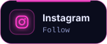
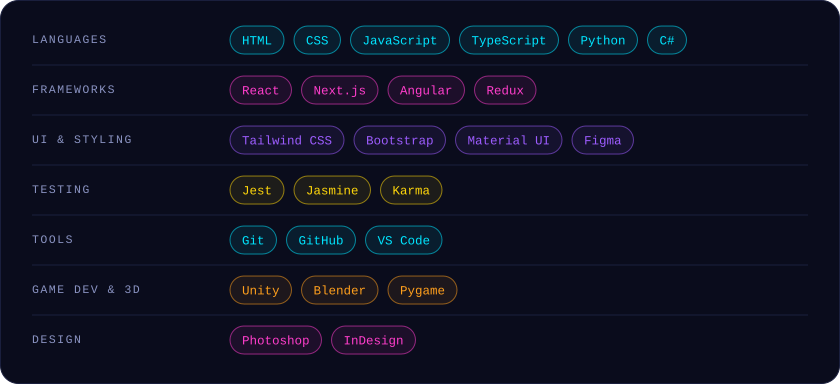
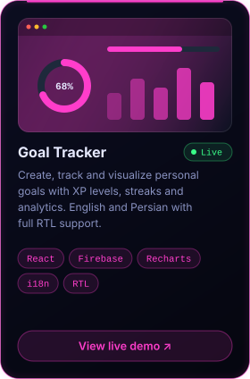

 

 

## About

I'm a Computer Science student who builds for the web with **React, Next.js, Angular** and **Python**. My experience spans academic, volunteer and professional work, from QA testing to full web apps, and I care about performance, accessibility and clean UX.

- **Building** scalable, responsive frontends with tested, maintainable code
- **Exploring** frontend architecture, design systems, robotics and game development
- **Open to** open-source, EdTech and collaborative projects

## Tech Stack

## Featured Projects

Source code: <a href="https://github.com/Satayesh-Esmaily/afghan-kaaryab">KaarYab</a> &nbsp;·&nbsp; <a href="https://github.com/Satayesh-Esmaily/Goal-Tracker-">Goal Tracker</a> &nbsp;·&nbsp; <a href="https://github.com/Satayesh-Esmaily/Product-Store-App">Product Store</a>

## Robotics & Game Development

- **Game development** with Unity, Blender and Python (Pygame for 2D games)
- **Robot programming** with Python-based control
- **Control systems** using sensor-based logic

## Experience

**QA Tester** — Code to Inspire · Remote · 7 months
Manual testing, bug reporting and test-case execution, with a focus on software quality, user experience and unit-test coverage.

**Vice President, Capacity Building Department** — Generation of Thinkers (GOT) · Volunteer · 2024 – 2025

## Education & Training

- **Code to Inspire** — Web Design, React.js, Next.js · 2025 – 2026
- **Pioneering mWoen Online School** — Robotics & Python Programming · 2024 – 2026
- **Hewad High School** — Grades 9 – 12 · 2023 – 2026

<b>Certifications</b> &nbsp;·&nbsp; Duolingo English Test 120 &nbsp;·&nbsp; Farsi (fluent), English (very good)

 

| Certification | Issuer | Year |
|:--|:--|:-:|
| Web Design Fundamentals (Grade A+) | Code to Inspire | 2025 |
| Representing Team Afghanistan, First Global Competition | Code to Inspire | 2025 |
| Shadowing Program & Seda App Hackathon | Code to Inspire | 2025 |
| Python Course | Cisco Networking Academy | 2025 |
| Cyber Security Course | Cisco Networking Academy | 2024 |
| PowerPoint Presentation Design & Formatting | Coursera | 2025 |
| Adobe InDesign Flyer Design Workshop | Coursera | 2025 |
| Children and the Digital Future Workshop | Femstech Worldwide | 2024 |
| English Course | Kings College London | 2023 – 2024 |
| Speech Course | AIL | 2023 |
| First Aid & Injections | AIL | 2024 |

## GitHub Activity

  

