

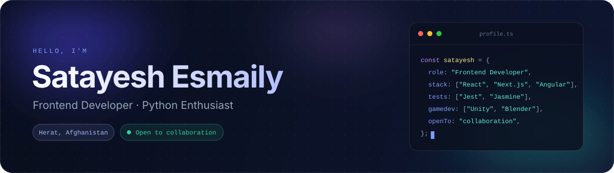

 

<a href="mailto:setayeshesmaily59@gmail.com">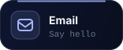</a>

 

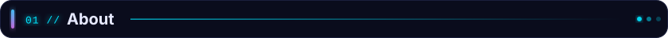

 

I'm a Computer Science student who builds for the web with **React, Next.js, Angular** and **Python**. My experience spans academic, volunteer and professional work, from QA testing to full web apps, and I care about performance, accessibility and clean UX.

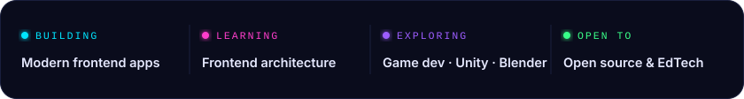

 

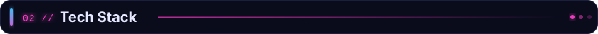

 

 

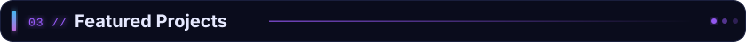

 

<a href="https://afghan-kaaryab.vercel.app/">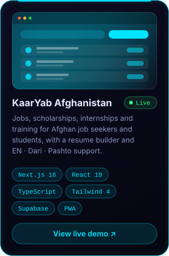</a>

<a href="https://github.com/HisabBook/hisab-book">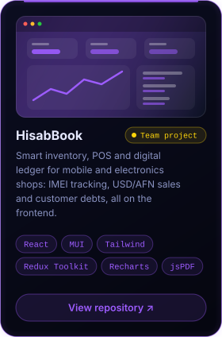</a>
<a href="https://github.com/Satayesh-Esmaily/Taply">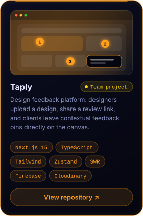</a>
<a href="https://github.com/Satayesh-Esmaily/Product-Store-App">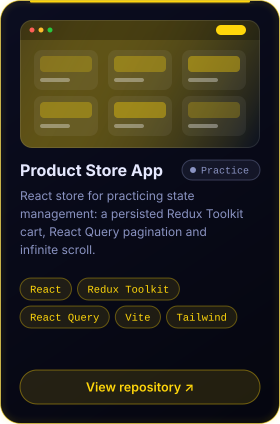</a>

Source code: <a href="https://github.com/Satayesh-Esmaily/afghan-kaaryab">KaarYab</a> &nbsp;·&nbsp; <a href="https://github.com/Satayesh-Esmaily/Goal-Tracker-">Goal Tracker</a> &nbsp;·&nbsp; <a href="https://github.com/HisabBook/hisab-book">HisabBook</a> &nbsp;·&nbsp; <a href="https://github.com/Satayesh-Esmaily/Taply">Taply</a> &nbsp;·&nbsp; <a href="https://github.com/Satayesh-Esmaily/Product-Store-App">Product Store</a>

 

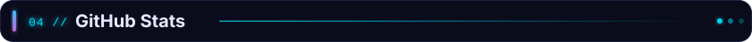

 

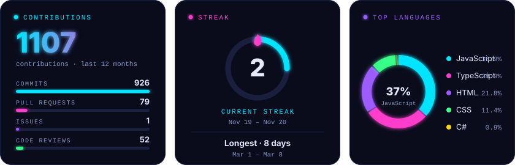

 

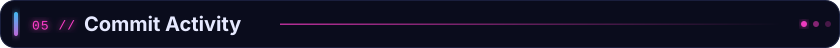

 

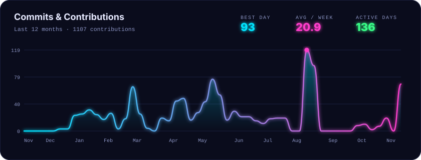

 

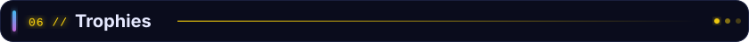

 

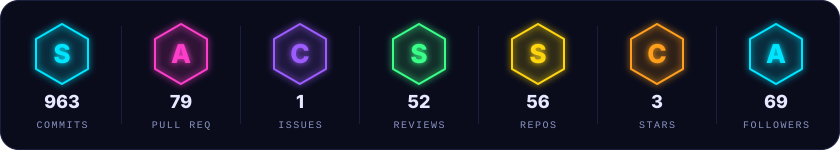

 

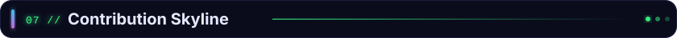

 

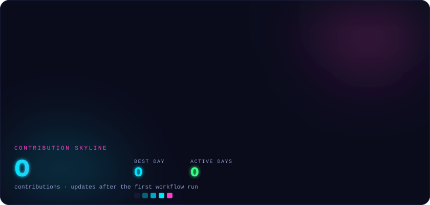

 

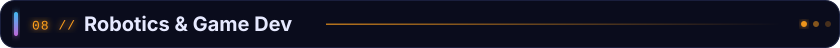

 

- **Game development** with Unity, Blender and Python (Pygame for 2D games)
- **Robot programming** with Python-based control
- **Control systems** using sensor-based logic

 

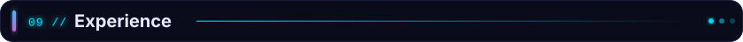

 

**QA Tester** — Code to Inspire · Remote · 7 months
Manual testing, bug reporting and test-case execution, with a focus on software quality, user experience and unit-test coverage.

**Vice President, Capacity Building Department** — Generation of Thinkers (GOT) · Volunteer · 2024 – 2025

 

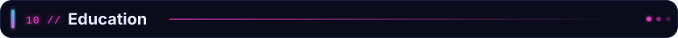

 

- **Code to Inspire** — Web Design, React.js, Next.js · 2025 – 2026
- **Pioneering mWoen Online School** — Robotics & Python Programming · 2024 – 2026
- **Hewad High School** — Grades 9 – 12 · 2023 – 2026

**Languages:** Farsi (fluent) · English (very good) · Duolingo English Test 120

 

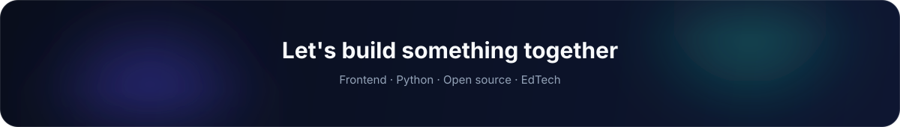

